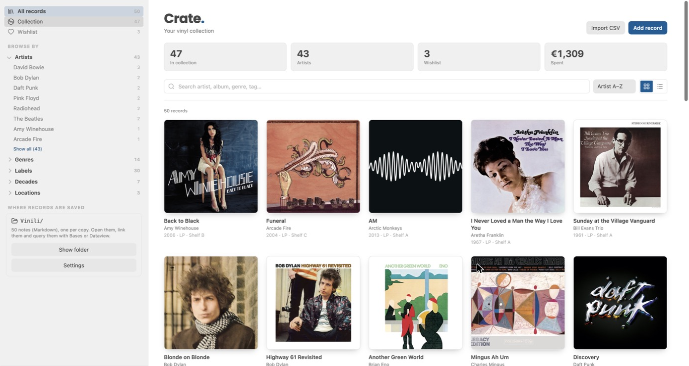
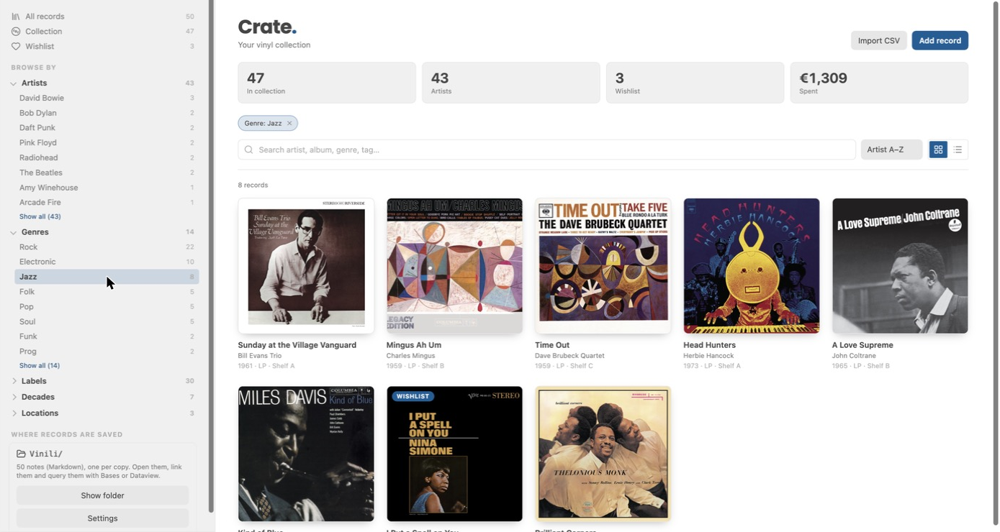
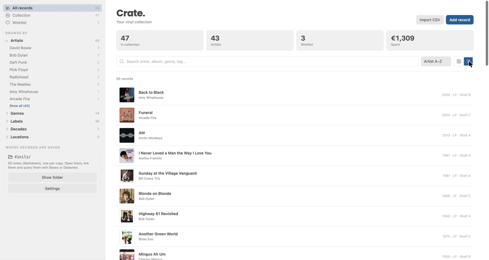
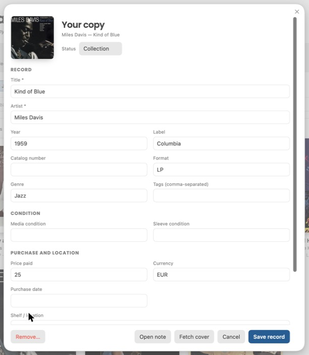

# Crate

**A vinyl collection manager for Obsidian.** Every record is a plain Markdown note, so your collection stays yours: searchable, linkable, and readable by Bases or Dataview. Crate adds the part Obsidian doesn't have: a cover grid you actually want to browse.



## Features

- **Cover grid and compact list**, with search and sorting (artist, title, year).
- **Browse by** artist, genre, label, decade, shelf location and tag, from a dedicated side panel. Every filter is a removable chip.
- **Real covers, no account needed.** Crate looks them up for you (public Apple search by artist and title). With a Discogs release ID and a personal token it uses Discogs instead.
- **CSV import** (Discogs exports and generic CSVs, comma or semicolon) with column mapping and a preview. Importing the same file twice never duplicates records, and two physical copies in one file stay two records.
- **Wishlist** next to your collection, with a running total of what you spent.
- **Follows your theme.** The accent colour comes from your Obsidian theme (light or dark), or pick your own.
- **English and Italian**, following the Obsidian language. More languages are one small object away (see [Contributing](#contributing)).
- Built for **desktop and mobile** (the mobile layout is in place but still untested on a real device). No runtime dependencies, no telemetry.

| Filter by anything | Compact list | Edit a record |
|---|---|---|
|  |  |  |

## Install

**Manual (works today)**

1. Download `main.js`, `manifest.json` and `styles.css` from the [latest release](https://github.com/Gusions/obsidian-crate/releases/latest).
2. Put them in `<your-vault>/.obsidian/plugins/crate/`.
3. In Obsidian: **Settings → Community plugins**, turn on community plugins, reload, then enable **Crate**.

**With [BRAT](https://github.com/TfTHacker/obsidian42-brat):** add `Gusions/obsidian-crate` as a beta plugin.

The first time it starts, the Crate panel opens in the left sidebar. If you close it, bring it back with the command **Crate: Show side panel** or the disc icon in the ribbon.

## Where your records live

Each copy is one note in the `Vinyl` folder (change it in **Settings → Crate**), with YAML frontmatter:

```yaml
---
crate: true
crate_id: 6b0b8c3e-…
title: "Kind of Blue"
artist: "Miles Davis"
year: "1959"
label: "Columbia"
format: "LP"
genre: "Jazz"
status: "collection"   # or "wishlist"
price: "25"
currency: "EUR"
location: "Shelf A"
cover: "https://…"
---
```

The body of the note is yours: reviews, links, listening notes. Editing a record in Crate only touches the properties Crate owns and leaves your text and any other properties alone. Removing a record uses Obsidian's own trash setting.

## Covers

- **Automatic (default).** When you save a record or import a CSV, Crate searches Apple's public catalogue by artist and title and stores the image URL in the `cover` property. This sends *artist and title* to Apple. Turn it off in **Settings → Crate → Automatic covers**. Run **Crate: Fetch missing covers** to fill in the rest of your collection (about one record every three seconds).
- **Discogs.** Add the *Discogs release ID* to a record and a personal token in the settings (create one at <https://www.discogs.com/settings/developers>). The token is kept in memory only; enter it again after restarting Obsidian.
- **Manual.** Paste any HTTPS image URL, or the path of an image inside your vault, into the *Cover* field.
- Covers are stored as links, so they need a connection to show. A record without a cover gets a drawn vinyl in your accent colour.
- Matching is deliberately strict: no confident match means no cover rather than the wrong one. In the demo collection used for the screenshots, 46 of 50 records were matched automatically.

## Importing a collection

Export your collection as CSV from Discogs or any other app, choose **Import CSV** in Crate, check the preview and match at least *Artist* and *Title*. Existing notes are never overwritten; rows without artist or title are skipped and counted. This is a one-way import: Crate never writes to your Discogs account.

## Settings

Notes folder · custom fields · language · theme colour or custom accent · cover size · automatic covers · Discogs token.

## Development

```sh
npm test         # unit tests, Node 20+, no dependencies
npm run build    # bundles src/core.js into src/main.js -> main.js
```

`src/core.js` holds the pure logic (CSV parser, column mapping, import identity, facets, price parsing, cover matching, translations) and is covered by tests. `src/main.js` is the plugin. `main.js` at the root is the generated bundle, kept in the repo so a release is just three files. CI fails if it is out of date.

## Contributing

Translations live in `STR` at the top of `src/core.js`. Copy the `en` object, translate the values, add it under its language code, and `npm test` will check that no key is missing. Bug reports and pull requests are welcome.

## Privacy

No analytics, no accounts, no server of mine. The only network requests are the ones you can see above: Apple's public search and Discogs (only if you add a token), plus the cover images themselves when shown.

## License

[GPL-3.0](LICENSE)
